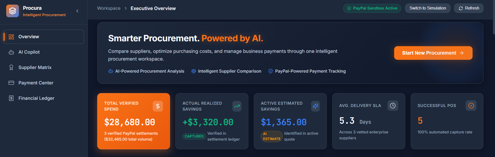
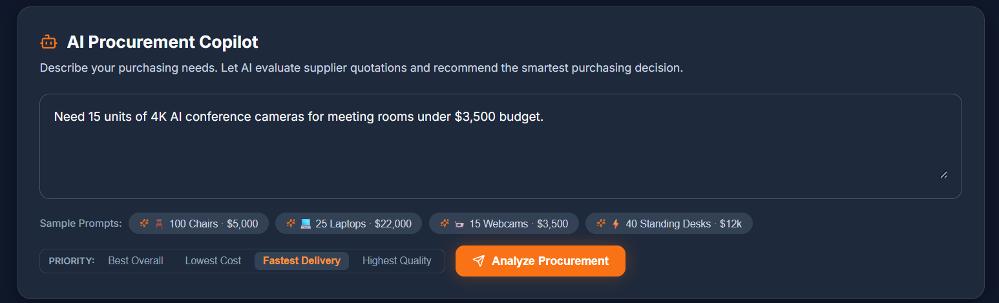
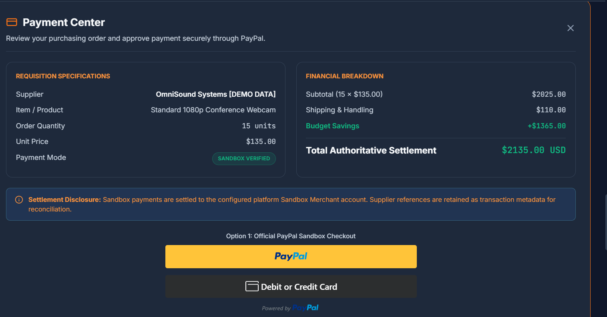

# Procura
> An AI-assisted B2B procurement copilot and financial settlement platform integrating Google Gemini, deterministic quotation evaluation, and the PayPal Orders API v2.

[](https://developer.paypal.com/docs/api/orders/v2/)
[](https://ai.google.dev/)
[](https://react.dev/)
[](https://vitejs.dev/)
[](https://www.ag-grid.com/)
[](https://tailwindcss.com/)

```text
  ██████╗ ██████╗  ██████╗  ██████╗██╗   ██╗██████╗  █████╗ 
  ██╔══██╗██╔══██╗██╔═══██╗██╔════╝██║   ██║██╔══██╗██╔══██╗
  ██████╔╝██████╔╝██║   ██║██║     ██║   ██║██████╔╝███████║
  ██╔═══╝ ██╔══██╗██║   ██║██║     ██║   ██║██╔══██╗██╔══██║
  ██║     ██║  ██║╚██████╔╝╚██████╗╚██████╔╝██║  ██║██║  ██║
  ╚═╝     ╚═╝  ╚═╝ ╚═════╝  ╚═════╝ ╚═════╝ ╚═╝  ╚═╝╚═╝  ╚═╝
```

---

## 01. Project Title and Tagline

- **Project Name**: Procura
- **Tagline**: Verifiable B2B Procurement Powered by Deterministic AI and PayPal Settlement.
- **Context**: Built as an individual project for the PayPal AI Hackathon 2026.

---

## 02. Project Overview

I built Procura to address a systemic operational gap in business-to-business purchasing: the disconnect between how purchasing decisions are evaluated and how payments are actually authorized, executed, and audited.

In many organizations, procurement begins with an operational need expressed in plain language. However, the evaluation process quickly fragments into manual spreadsheet comparisons, conflicting vendor terms, and disconnected invoice handoffs. When payments are finally made, financial controllers often find that negotiated volume discounts or shipping terms were lost in translation.

Procura bridges this gap by unifying three core capabilities into a single workspace:
1. **Natural Language Requisition Processing**: An AI-assisted pipeline powered by Google Gemini that extracts structured operational parameters from unstructured buyer intent.
2. **Deterministic Evaluation and Risk Modeling**: A backend evaluation engine that calculates landed costs in integer cents, pre-filters vendors by inventory and budget limits, and ranks compliant options across five objective dimensions.
3. **Verified PayPal Settlement**: A human-in-the-loop authorization gate backed by the PayPal Orders API v2, with server-side authoritative pricing, integer-cent capture verification, and persistent audit logging in AG Grid.

---

## 03. Problem Statement

Through my research into corporate purchasing workflows, I identified four recurring structural failure points:

1. **Evaluation Friction and Latency**: Comparing multi-supplier proposals across variable unit costs, batch freight rates, delivery lead times, and commercial warranty periods requires hours of manual spreadsheet data entry.
2. **Generative Model Arithmetic Hazards**: While Large Language Models excel at syntactic comprehension, they are non-deterministic and prone to arithmetic hallucinations. Relying on an LLM to compute budgets, multiply currency values, or enforce hard financial caps introduces unacceptable operational risk.
3. **Disjointed Financial Execution**: When purchasing decisions occur in chat threads or email chains, the payment transaction is detached from the agreed quotation parameters. This leads to invoice discrepancies, unbudgeted freight surcharges, and audit reconciliation headaches.
4. **The Savings Verification Disconnect**: Procurement teams frequently report "estimated savings" during supplier negotiations that never translate into verified "realized savings" in financial accounting records post-payment.

---

## 04. Solution and How Procura Works

Procura solves these challenges through a deliberate architectural boundary: **Generative AI is used strictly for semantic comprehension and comparative risk reasoning, while all financial calculations, catalog filtering, and ranking decisions are strictly enforced by deterministic backend code.**

The end-to-end operational flow proceeds through seven distinct stages:
1. **Requisition**: The buyer enters a purchasing request in plain text (e.g., *"Procure 25 enterprise laptops with 16GB RAM for engineers within a $22,000 budget"*).
2. **Structured Extraction**: Google Gemini parses the text against a typed JSON schema to extract standardized fields: item description, category, quantity, budget limit, and priority.
3. **Catalog Retrieval and Pre-Filtering**: The Express backend retrieves matching quotes from persistent storage and pre-filters candidates. Any supplier with insufficient stock or whose landed cost exceeds the budget is disqualified with an explicit audit reason.
4. **Deterministic Multi-Factor Scoring**: Compliant vendors are scored and ranked across five weighted dimensions using range-normalized formulas.
5. **Cognitive Risk Reasoning**: Gemini inspects the structured quotation dataset and produces an executive recommendation narrative alongside explicit operational risk assessments for competing options.
6. **Human Authorization**: The buyer inspects the comparative matrix, reviews the landed cost breakdown, and must explicitly approve the order before any payment call is permitted.
7. **PayPal Settlement and Ledger Commitment**: The backend creates an authoritative PayPal Sandbox order, the buyer approves it via PayPal Smart Buttons, and the server captures the transaction with integer-cent matching before writing the record to the persistent audit ledger.

---

## 05. Key Features

- **Multi-Step AI-Assisted Architecture**: Uses Google Gemini (`gemini-3.1-flash-lite`) via `@google/genai` with strict `responseSchema` validation for requirement extraction and qualitative risk analysis, while isolating financial math to backend services.
- **Five-Dimension Supplier Matrix**: Evaluates suppliers across landed price, delivery lead time, warranty tier, stock availability cushion, and operational risk level.
- **Strict Human-in-the-Loop Control**: Financial transactions cannot be triggered autonomously by AI. Every settlement requires an explicit human authorization action.
- **Authoritative Server-Side Pricing**: The backend computes landed costs directly from persistent supplier records, completely ignoring any client-submitted price parameters to prevent DOM tampering.
- **Integer-Cent Currency Math**: Eliminates floating-point rounding errors (`0.1 + 0.2 !== 0.3`) by converting all monetary values to exact integer cents for calculation and verification.
- **PayPal Orders API v2 Integration**: Automated OAuth2 token management with in-memory caching, server-side order generation, and exact-cent capture verification.
- **Idempotency Protection**: Enforces an order state machine (`CREATED` -> `CAPTURED`) in persistent storage, preventing duplicate captures or replay submissions.
- **Executive Savings Dashboard**: Visualizes procurement performance using Recharts, featuring a Spend by Category hollow donut chart and a Purchasing Volume gradient area chart.
- **Clear Savings Distinction**: Strictly isolates *Active Estimated Savings* (quotation benchmarks) from *Actual Realized Savings* (accrued solely upon successful payment capture).
- **Persistent Financial Audit Ledger**: Built with AG Grid Community, featuring multi-column sorting, live search filtering, status badges, and one-click CSV export.
- **Dual-Mode Operation**: Seamlessly toggles between live PayPal Sandbox transactions and an isolated Simulation Mode for offline evaluation and automated testing.

---

## 06. Procurement Workflow

```text
[ Buyer Requisition Input ]
       │ "Procure 25 enterprise laptops with 16GB RAM for engineers under $22,000"
       ▼
[ Step 1: Gemini Parameter Extraction ]
       │ Schema: { item, category, quantity, maxBudget, priority }
       ▼
[ Step 2: Catalog Retrieval & Pre-Filtering ]
       │ • Disqualify vendors if stock < requested quantity
       │ • Disqualify vendors if landed cost > max budget
       ▼
[ Step 3: Deterministic Multi-Factor Scoring ]
       │ • Range-normalized cost score: 100 * (MaxCost - Cost) / (MaxCost - MinCost)
       │ • Delivery speed, warranty tier, and supplier rating weighting
       │ • Deterministic tie-breaker resolution
       ▼
[ Step 4: Gemini Cognitive Risk Reasoning ]
       │ • Generates executive recommendation narrative
       │ • Evaluates operational and supply chain risks of alternative vendors
       ▼
[ Step 5: Human Approval Gate ]
       │ Buyer reviews matrix and clicks "Approve & Settle"
       ▼
[ Step 6: Server-Side PayPal Order Creation ]
       │ POST /v2/checkout/orders (intent: "CAPTURE", user_action: "PAY_NOW")
       ▼
[ Step 7: PayPal Smart Buttons Authorization ]
       │ Buyer authenticates in PayPal modal and authorizes purchase
       ▼
[ Step 8: Capture & Integer-Cent Verification ]
       │ POST /v2/checkout/orders/{id}/capture
       │ Asserts: toCents(capturedAmount) === toCents(order.amount)
       ▼
[ Step 9: Persistent Ledger Logging ]
       │ Appends transaction to transactions.json with SANDBOX_VERIFIED badge
       │ Updates Realized Savings KPI and refreshes dashboard analytics
```

---

## 07. Architecture Diagram

```text
┌────────────────────────────────────────────────────────────────────────────────────────┐
│                              CLIENT LAYER (React 18 + Vite)                            │
│                                                                                        │
│  ┌───────────────────────┐  ┌─────────────────────────┐  ┌─────────────────────────┐  │
│  │ Executive Dashboard   │  │ 5-Dimension Supplier    │  │ AG Grid Financial Ledger│  │
│  │ Hero KPI + Recharts   │  │ Intelligence Matrix     │  │ Filterable Audit & CSV  │  │
│  └───────────────────────┘  └─────────────────────────┘  └─────────────────────────┘  │
│                                           │                                            │
│                                           ▼                                            │
│                       ┌───────────────────────────────────────┐                        │
│                       │  PayPal Smart Payment Buttons Modal   │                        │
│                       └───────────────────────────────────────┘                        │
└───────────────────────────────────────────┬────────────────────────────────────────────┘
                                            │ HTTP / JSON API Calls
                                            ▼
┌────────────────────────────────────────────────────────────────────────────────────────┐
│                              SERVER LAYER (Node.js + Express)                          │
│                                                                                        │
│  ┌────────────────────────┐  ┌─────────────────────────┐  ┌─────────────────────────┐  │
│  │  /api/agent/procure    │  │ /api/paypal/create-order│  │ /api/paypal/capture-ord │  │
│  └───────────┬────────────┘  └────────────┬────────────┘  └────────────┬────────────┘  │
│              │                            │                            │               │
│              ▼                            ▼                            ▼               │
│  ┌────────────────────────┐  ┌─────────────────────────┐  ┌─────────────────────────┐  │
│  │ Gemini Extraction &    │  │ Authoritative Landed    │  │ Cent-Level Verification │  │
│  │ Risk Reasoning Service │  │ Cost Calculation Engine │  │ & Order State Machine   │  │
│  └───────────┬────────────┘  └────────────┬────────────┘  └────────────┬────────────┘  │
└──────────────┼────────────────────────────┼────────────────────────────┼───────────────┘
               │                            │                            │
               ▼                            ▼                            ▼
   ┌───────────────────────┐    ┌─────────────────────────────────────────────────────┐
   │ Google Gemini API     │    │ PayPal Sandbox REST API v2                          │
   │ gemini-3.1-flash-lite │    │ • POST /v1/oauth2/token (Client Credentials)        │
   │ • Schema Extraction   │    │ • POST /v2/checkout/orders (Order Creation)         │
   │ • Risk Analysis       │    │ • POST /v2/checkout/orders/{id}/capture (Capture)    │
   └───────────────────────┘    └─────────────────────────────────────────────────────┘
```

---

## 08. Technology Stack

| Domain | Technology / Library | Version | Implementation Role |
| :--- | :--- | :--- | :--- |
| **Frontend Framework** | **React** | `^18.3.1` | Single-page state coordination, workflow navigation, and component lifecycle. |
| **Build Tooling** | **Vite** | `^6.2.0` | Fast development server and production Rollup bundling. |
| **Styling & Theme** | **Tailwind CSS** | Custom Tokens | Slate-900 (`#0F172A`) base, Slate-800 surfaces, Orange (`#F97316`), and Blue (`#3B82F6`). |
| **Data Visualization** | **Recharts** | `^3.10.1` | Hollow Donut Chart (Spend by Category) and Gradient Area Chart (Volume Over Time). |
| **Data Grid & Ledger** | **AG Grid Community** | `^33.1.1` | High-density audit ledger with multi-column sorting, text search, and CSV export. |
| **Payment SDK** | **`@paypal/react-paypal-js`** | `^8.8.2` | Official React wrapper for PayPal JavaScript SDK Smart Buttons. |
| **Iconography** | **Lucide React** | `^0.475.0` | Enterprise iconography across dashboard metrics and tables. |
| **Backend Runtime** | **Node.js** | `>=18.0.0` | Server-side execution environment (tested on Node v24.13.0). |
| **Web Framework** | **Express.js** | `^4.21.2` | REST API routing, CORS handling, and JSON body parsing. |
| **AI SDK** | **`@google/genai`** | `^0.15.0` | Google Gen AI SDK executing `gemini-3.1-flash-lite` with typed output schemas. |
| **Payment API** | **PayPal Orders API v2** | `v2` | RESTful order creation, capture execution, and OAuth2 token management. |
| **HTTP Client** | **Axios** | `^1.7.9` | Outbound HTTP requests to PayPal Sandbox endpoints. |
| **Arithmetic Engine** | Custom Utility | Internal | Pure integer-cent currency conversion and math utility (`toCents`, `fromCents`). |
| **Persistence** | File-based JSON Storage | Internal | Local persistent storage for suppliers, pending orders, and audit transactions. |

---

## 09. Screenshots and Visual Walkthrough

### 1. Executive Procurement Dashboard
The central dashboard displays top-level KPIs including Total Verified Spend, Actual Realized Savings, Active Estimated Savings, Average Delivery SLA, and Completed Purchase Orders. The hero metric card uses the primary Orange theme (`#F97316`) against the Slate-900 background (`#0F172A`).



---

### 2. Capital Allocation and Category Visualizations
Interactive Recharts components provide immediate financial transparency. The hollow donut chart illustrates spend distribution across equipment categories, while the smooth gradient area chart tracks committed capital over time.


---

### 3. Natural Language Procurement Copilot
Buyers submit procurement requisitions using plain language. Quick-select benchmark chips allow instant evaluation across multiple categories including ergonomic seating, enterprise laptops, 4K conference webcams, and motorized standing desks.



---

### 4. Gemini Agent Analysis and Parameter Extraction
The copilot renders the parsed requisition parameters (item, category, quantity, budget limit, optimization priority) alongside Gemini's executive recommendation narrative.


---

### 5. Five-Dimension Supplier Quotation Matrix
Suppliers are evaluated across Price & Landed Cost, Delivery Time, Commercial Warranty, Stock Cushion, and Operational Risk Level. Vendors that fail inventory or budget constraints are pre-filtered and marked with clear disqualification notices.


---

### 6. Executive Recommendation and Alternative Risk Analysis
The top-ranked vendor is surfaced with verified landed cost totals and calculated savings potential. Directly below, an alternative risk panel discloses explicit operational, delivery, and warranty trade-offs for non-selected suppliers.


---

### 7. Human-in-the-Loop PayPal Settlement Center
When an approved quote is selected, the payment section loads the authoritative purchase summary and mounts official PayPal Smart Payment Buttons. Payment cannot be initiated without explicit buyer interaction.



---

### 8. Payment Capture and Transaction Verification
Upon buyer authorization in the PayPal modal, the backend captures the transaction and verifies that the captured amount matches the authoritative server price to the exact integer cent. A completion receipt displays the verified PayPal Capture ID.


---

### 9. Financial Audit Ledger (AG Grid Community)
Every completed settlement is permanently recorded in the AG Grid audit ledger with its PO ID, authentic PayPal Order ID, PayPal Capture ID, timestamp, and verified Realized Savings. The table supports full-text search, column filters, and one-click CSV export.


---

## 10. PayPal Integration Details

My implementation of the PayPal integration enforces strict separation between client-side user experience and server-side financial authority.

### 1. In-Memory OAuth2 Token Lifecycle
In [`server/services/paypalService.js`](server/services/paypalService.js), I implemented an in-memory OAuth2 token manager. It requests access tokens from `POST /v1/oauth2/token` using HTTP Basic Authentication (`clientId:clientSecret`). The token is cached in memory with a 5-minute pre-expiration buffer to eliminate authentication latency during live checkout sessions.

### 2. Server-Side Authoritative Order Creation
Client-submitted prices are intentionally discarded. The backend retrieves the supplier record from `server/data/suppliers.json` and computes the exact landed cost:
$$\text{Landed Cost} = (\text{Unit Price} \times \text{Quantity}) + \text{Shipping Cost}$$

The backend calls PayPal's `POST /v2/checkout/orders` with:
```javascript
const orderPayload = {
  intent: "CAPTURE",
  purchase_units: [{
    custom_id: supplier.supplierId,
    description: `Procura Settlement: ${supplier.product} (${quantity} units)`,
    amount: {
      currency_code: "USD",
      value: landedCost.toFixed(2)
    }
  }],
  application_context: {
    brand_name: "Procura",
    landing_page: "NO_PREFERENCE",
    user_action: "PAY_NOW",
    shipping_preference: "NO_SHIPPING"
  }
};
```
Setting `user_action: "PAY_NOW"` instructs PayPal to render a definitive "Pay Now" button in the modal, giving the buyer immediate clarity on the finality of the transaction. The resulting order ID is stored in `server/data/orders.json` with status `CREATED`.

### 3. Exact Integer-Cent Capture Validation
When the buyer approves payment in the PayPal modal, the frontend transmits the `orderID` to `POST /api/paypal/capture-order`. The server invokes PayPal's capture endpoint (`POST /v2/checkout/orders/{id}/capture`) with a unique `PayPal-Request-Id` idempotency header.

Upon receipt of the capture response, the server validates the funds in exact integer cents:
```javascript
const capturedCents = toCents(captureUnit.amount.value);
const expectedCents = toCents(order.amount);

if (capturedCents !== expectedCents) {
  throw new Error(
    `Financial mismatch: expected ${expectedCents} cents ($${order.amount}), ` +
    `but captured ${capturedCents} cents ($${captureUnit.amount.value}).`
  );
}
```

### 4. Idempotent State Locking and Resilient Order Lifecycle
To prevent double-capture submissions, race conditions, and accidental replay attempts, `captureOrder` enforces an explicit order lifecycle backed by an asynchronous mutex (`fileMutex` in [`server/utils/storage.js`](server/utils/storage.js)):

$$\text{CREATED} \xrightarrow{\text{capture requested}} \text{CAPTURING} \xrightarrow{\text{PayPal capture verified}} \text{CAPTURED}$$

```javascript
// Double capture and concurrency protection
if (order.status === 'CAPTURED') {
  const error = new Error(`Order "${orderId}" has already been captured and settled.`);
  error.statusCode = 409;
  throw error;
}

if (order.status === 'CAPTURING') {
  const error = new Error(`Payment capture for order "${orderId}" is currently in progress. Please wait.`);
  error.statusCode = 409;
  throw error;
}

if (order.status === 'MANUAL_RECONCILIATION_REQUIRED' || order.status === 'CAPTURE_UNKNOWN') {
  const error = new Error(`Order "${orderId}" is in reconciliation state. Re-capture is blocked to prevent duplicate charges.`);
  error.statusCode = 409;
  throw error;
}
```

#### Safe Error Classification:
- **Pre-Capture Failures (`ORDER_NOT_APPROVED`)**: The buyer has not authorized the order in the PayPal modal. Funds were never collected. The order safely resets to `CREATED` so the buyer can re-attempt checkout.
- **Post-Capture Discrepancies**: If PayPal captures the funds but an integer-cent check fails, the order transitions to `MANUAL_RECONCILIATION_REQUIRED` and persists the capture ID. It is strictly blocked from re-capture to eliminate double-charging.
- **Uncertain Outcomes (Network Drop / Gateway Timeout)**: If the connection terminates during capture dispatch, the order locks into `CAPTURE_UNKNOWN`. A dedicated reconciliation routine (`reconcileOrderWithPayPal()`) queries PayPal's `GET /v2/checkout/orders/{id}` to verify payment status before releasing the state.

#### Atomic Ledger Recording and Startup Auto-Recovery:
Both order persistence and ledger writing are protected by serialized locks (`transactions-ledger-lock`). Ledger recording is strictly idempotent by `paypalOrderId` and `paypalCaptureId`. On server reboot, `reconcileLedgerAndOrders()` automatically checks for any captured orders missing ledger records and unsticks any orders interrupted during a server crash.

> **Single-Process vs. Enterprise Note**: The in-memory mutex coordinates concurrent requests within a single Node.js process instance (appropriate for hackathon demonstrations). For multi-instance clustered enterprise deployments, this boundary transitions to distributed PostgreSQL row-level locks (`SELECT ... FOR UPDATE`) or Redis Redlock.

---

## 11. Gemini AI Integration Details

I integrated Google Gemini (`gemini-3.1-flash-lite`) using the official `@google/genai` SDK in [`server/services/geminiService.js`](server/services/geminiService.js).

Rather than relying on unconstrained chat completions, the integration operates as a structured multi-step pipeline:

### Step 1: Typed Parameter Extraction
The user's prompt is processed using Gemini's structured output capability (`responseSchema`) with temperature set to `0.1`:
```javascript
responseSchema: {
  type: "OBJECT",
  properties: {
    item: { type: "STRING" },
    category: { type: "STRING" },
    quantity: { type: "INTEGER" },
    maxBudget: { type: "NUMBER" },
    priority: { type: "STRING", enum: ["cost", "speed", "quality", "balanced"] }
  },
  required: ["item", "quantity", "maxBudget"]
}
```
If the extraction service encounters rate limits or network issues, a heuristic fallback parser in `server/services/procurementService.js` safely extracts baseline requirements using regular expressions.

### Step 2: Cognitive Trade-Off and Risk Reasoning
After the backend deterministic engine filters and scores the supplier catalog, the structured dataset (including unit prices, freight, warranties, stock levels, and operational constraints) is passed to Gemini with a structured reasoning schema:
```javascript
responseSchema: {
  type: "OBJECT",
  properties: {
    executiveRecommendation: { type: "STRING" },
    supplierRisks: {
      type: "ARRAY",
      items: {
        type: "OBJECT",
        properties: {
          supplierId: { type: "STRING" },
          supplierName: { type: "STRING" },
          riskLevel: { type: "STRING" },
          riskSummary: { type: "STRING" }
        },
        required: ["supplierId", "riskSummary"]
      }
    }
  },
  required: ["executiveRecommendation", "supplierRisks"]
}
```
This enables Gemini to articulate nuanced operational trade-offs—such as explaining why a vendor with a 9-day lead time and higher freight fees poses greater logistical risk, or why an alternative vendor's limited inventory buffer creates a stockout vulnerability—while leaving financial totals strictly determined by backend arithmetic.

---

## 12. Simulation Mode

Procura includes a complete **Simulation Mode** designed for demonstration environments, automated testing, and evaluation without requiring live PayPal Sandbox credentials.

- **Explicit User Control**: The mode can be toggled on or off at any time using the "Switch to Simulation" button in the top navigation bar. If PayPal Sandbox credentials are not configured in `server/.env`, the system automatically defaults to Simulation Mode.
- **Identical Mathematical Rigor**: Simulation Mode executes the exact same deterministic 5-dimension scoring algorithm, range-normalized price calculations, and stock constraint filtering.
- **Clear Audit Labelling**: Simulated transactions generate identifiers prefixed with `SIM-TXN-2026-XXXX`, pending orders are prefixed with `SIM-ORDER-...`, and ledger entries are explicitly marked with `SIMULATION` badges.
- **Honest Differentiation**: The simulation engine never fabricates fake PayPal capture IDs or makes false claims of real money movement.

---

## 13. Verified API Endpoints

All endpoints are hosted on the Express backend (`http://localhost:5000` by default):

### Health and Configuration
- `GET /api/health`
  - Returns service status, active port, and boolean configuration flags (`geminiConfigured`, `paypalSandboxConfigured`, `paypalClientId`).

### AI Copilot
- `POST /api/agent/procure`
  - **Body**: `{ "prompt": string }`
  - **Returns**: Parsed requirements, candidate comparison array, Gemini recommendation narrative, alternative supplier risk analysis, and audit tool trace.

### PayPal Settlement
- `POST /api/paypal/create-order`
  - **Body**: `{ "supplierId": string, "quantityRequested": number, "maxBudget": number, "forceSimulation": boolean }`
  - **Returns**: Authoritative order ID (`orderID`), mode (`SANDBOX` or `SIMULATION`), and calculated landed cost.
- `POST /api/paypal/capture-order`
  - **Body**: `{ "orderID": string, "procurementMetadata": object }`
  - **Returns**: Verification status (`COMPLETED`), capture ID, payment mode (`SANDBOX_VERIFIED` or `SIMULATION`), and realized savings.

### Financial Ledger
- `GET /api/ledger/transactions`
  - **Returns**: Array of all persistent transaction records sorted newest first.
- `GET /api/ledger/stats`
  - **Returns**: Aggregated metrics segregated by mode (Sandbox spend and savings, Simulation spend, Sample benchmark data, total order counts).
- `GET /api/ledger/export/csv`
  - **Returns**: Downloadable CSV file containing the complete transaction audit log.

### Supplier Catalog
- `GET /api/suppliers`
  - **Returns**: Array of all available suppliers with unit prices, inventory, delivery SLAs, warranties, and risk levels.
- `GET /api/suppliers/:id`
  - **Returns**: Individual supplier record by `supplierId`.

---

## 14. Installation and Setup

### Prerequisites
- **Node.js**: v18.0.0 or later (tested on v24.13.0)
- **npm**: v9.0.0 or later (tested on v11.6.2)
- **Git**: For repository cloning

### Installation Steps

1. **Clone the repository**:
   ```bash
   git clone https://github.com/nishitha-lochan/Procura.git
   cd Procura
   ```

2. **Install all dependencies**:
   ```bash
   npm run install:all
   ```
   *This root script automatically executes `npm install` across both `server/` and `client/` directories.*

   Alternatively, you can install them manually:
   ```bash
   cd server && npm install
   cd ../client && npm install
   cd ..
   ```

---

## 15. Environment Variables

Create a `.env` file in the `server` directory:

```bash
cp server/.env.example server/.env
```

Configure the following variables in `server/.env`:

```env
# ==========================================
# Google Gemini API Configuration
# ==========================================
# Obtain an API key from Google AI Studio: https://aistudio.google.com
GEMINI_API_KEY=your_gemini_api_key_here
GEMINI_MODEL=gemini-3.1-flash-lite

# ==========================================
# PayPal Sandbox API Configuration
# ==========================================
# Obtain credentials from PayPal Developer Portal: https://developer.paypal.com
PAYPAL_CLIENT_ID=your_paypal_sandbox_client_id_here
PAYPAL_CLIENT_SECRET=your_paypal_sandbox_client_secret_here
PAYPAL_API_BASE=https://api-m.sandbox.paypal.com

# ==========================================
# Express Server Configuration
# ==========================================
PORT=5000
```

> **Note on Security and Fallbacks**: `server/.env` is strictly git-ignored. If you do not provide Gemini or PayPal keys, Procura automatically activates its deterministic fallback engine and Simulation Mode, allowing the application to be evaluated with zero configuration.

---

## 16. Running the Application

Procura requires both the Express backend and the Vite client to run simultaneously:

### Option A: Run Using Root Scripts (Two Terminals)

**Terminal 1 — Express Backend**:
```powershell
npm run server
```
*Starts the server at `http://localhost:5000` using Node's native watch mode (`node --watch server.js`).*

**Terminal 2 — Vite Frontend**:
```powershell
npm run client
```
*Starts the client development server at `http://localhost:3000` with active Hot Module Replacement.*

### Option B: Build and Preview Frontend Production Bundle
```powershell
cd client
npm run build
npm run preview
```
*Compiles the optimized production bundle in `client/dist`.*

---

## 17. Testing and Verification

I developed a comprehensive automated test suite in [`server/tests/testScoring.js`](server/tests/testScoring.js) to verify mathematical precision, 5-dimensional scoring, catalog evaluation, heuristic extraction, server-side validation, and payment state machines.

To execute the test suite:
```powershell
npm test
```
*(Or navigate to `server/` and run `node tests/testScoring.js`).*

### Test Coverage Summary (121 Executed Passing Assertions Across 10 Verification Domains):
All automated tests execute against an isolated temporary test fixture directory initialized with fresh empty collections (`orders.json` and `transactions.json`) and created/torn down in `testScoring.js`. This guarantees zero test artifact leakage into production data files and ensures complete test determinism independent of historical demo activity. Runtime financial records (`orders.json` and `transactions.json`) initialize empty (`[]`) by default and are excluded from Git via `.gitignore`, while baseline demonstration records are safely preserved in `server/data/seed/` (`sample_orders.json` and `sample_transactions.json`) as optional demonstration fixtures.

- **1. Financial Precision & Integer Cents (18 tests)**: Asserts that `toCents()` eliminates floating-point currency drift (`0.1 + 0.2 === 0.3`), tests string parsing, null/NaN sanitization, landed cost calculation, and budget-relative savings. Validates strict positive integer parsing (accepts `10`, `"25"`; rejects decimals `2.5`, `"2.5"`, malformed strings `"10abc"`, zero, negatives, and NaN).
- **2. 5-Dimensional Scoring Engine (25 tests)**:
  - *Landed Cost (35%)*: Range-normalized score bounds (cheapest = 100, most expensive = 0, midpoint = 50, identical prices = 100).
  - *Delivery SLA (20%)*: Lead-time score decay (2-day = 90, 5-day = 75, 9-day = 55).
  - *Warranty Coverage (15%)*: Evaluates commercial warranty terms (5-Year = 100, 3-Year = 70, 1-Year = 40, Lifetime = 100, None = 0).
  - *Stock Availability Cushion (15%)*: Measures inventory depth ratio (insufficient = 0, exact match = 50, 5x+ cushion = 100).
  - *Operational Risk (15%)*: Evaluates risk tiers (Low: 90+, Med: ~60, High: <= 40) blended with verified supplier ratings.
  - *Weight Verification*: Validates that weights for all priority profiles (`balanced`, `cost`, `speed`, `quality`) sum to exactly 1.0 (100%).
- **3. Quotation Comparison & Ranking (11 tests)**: Validates full catalogue ranking, stock and budget pre-filtering (SUP-003 disqualified for 80 < 100 units), zero budget handling, over-budget rejection, and empty catalogue safety.
- **4. Requirement Extraction & Heuristics (7 tests)**: Verifies that delivery days ("5 days") are never mistaken for order quantity and product model numbers ("5540") are never mistaken for budget or quantity.
- **5. Server-Side Order Validation (9 tests)**: Validates that `createOrder` enforces positive integer quantities (rejecting negatives, decimals `2.5`, and strings `"10abc"` with HTTP 400), rejects non-existent suppliers (404), rejects orders exceeding available inventory (400), and rejects orders exceeding budget caps (400).
- **6. Order State Machine & Double-Capture Protection (4 tests)**: Verifies `CREATED` -> `CAPTURING` -> `CAPTURED` lifecycle, validates successful simulation capture with integer cents, rejects invalid order IDs (404), and strictly blocks double capture attempts with HTTP 409 Conflict.
- **7. PayPal Capture Reconciliation & Mismatch Defense (17 tests)**: Tests that PayPal `COMPLETED` capture amounts and currencies are verified against stored authoritative values; rejects capture amount mismatches, currency mismatches, missing currency codes, and non-`COMPLETED` capture statuses (e.g. `PENDING`) by transitioning to `MANUAL_RECONCILIATION_REQUIRED`; asserts that no falsified ledger entry is created on mismatch; and verifies that reconciliation creates exactly 1 idempotent ledger row.
- **8. Concurrent Order Creation & Parallel Capture Safety (17 tests)**: Concurrently creates 5 distinct orders under `orders-file-lock` to verify that no order record is overwritten; executes 3 concurrent captures in parallel under `order-lock-${orderId}` and `transactions-ledger-lock` to assert that all 3 orders transition to `CAPTURED` and commit distinct ledger transactions.
- **9. Ledger Failure Recovery & Gemini Financial Narrative (11 tests)**: Simulates a crash between order write and ledger write, asserting that `reconcileLedgerAndOrders()` automatically recovers missing ledger transactions; verifies that `buildAuthoritativeRecommendationNarrative()` strictly enforces deterministic landed cost, budget, savings, and scores, while cleansing any hallucinated dollar amounts from LLM text.
- **10. Storage Integrity & Corrupted File Protection (2 tests)**: Validates that `readJsonFile()` throws a critical `CORRUPTED_JSON_FILE` exception upon encountering malformed JSON syntax rather than silently wiping data or returning default values, while preserving safe fallback for legitimate missing files (`ENOENT`).

Verified test output:
```text
================================================================
     PROCURA — COMPREHENSIVE PRODUCTION TEST SUITE             
================================================================

--- 1. Financial Precision & Integer Cents ---
✅ PASS: Integer cents eliminates floating-point arithmetic error (0.1 + 0.2 === 0.3)
✅ PASS: toCents handles formatted dollar strings ($4,450.00 -> 445000)
✅ PASS: toCents trims and parses spaced currency strings
✅ PASS: toCents handles null, undefined, and NaN safely
✅ PASS: fromCents formats back to exact two decimal places
✅ PASS: fromCents formats 0 to 0.00
✅ PASS: calculateLandedCost calculates exact (42.00 * 100) + 250.00 = 4450.00 (got 4450)
✅ PASS: calculateEstimatedSavings calculates $5000 - $4450 = $550
✅ PASS: calculateEstimatedSavings returns 0 when cost exceeds budget
✅ PASS: calculateEstimatedSavings returns 0 when budget is unspecified
✅ PASS: isStrictPositiveInteger accepts positive integer (10)
✅ PASS: isStrictPositiveInteger accepts clean numeric string ("25")
✅ PASS: isStrictPositiveInteger strictly rejects decimal numbers (2.5)
✅ PASS: isStrictPositiveInteger strictly rejects decimal strings ("2.5")
✅ PASS: isStrictPositiveInteger strictly rejects alphanumeric strings ("10abc")
✅ PASS: isStrictPositiveInteger strictly rejects 0
✅ PASS: isStrictPositiveInteger strictly rejects negative numbers
✅ PASS: isStrictPositiveInteger strictly rejects NaN and null

--- 2. 5-Dimensional Scoring Engine ---
✅ PASS: Cheapest compliant vendor gets 100 (got 100)
✅ PASS: Most expensive compliant vendor gets 0 (got 0)
✅ PASS: Midpoint cost gets 50 (got 50)
✅ PASS: Equal prices yield 100 without division-by-zero (got 100)
✅ PASS: 2-day delivery yields speed score 90
✅ PASS: 5-day delivery yields speed score 75
✅ PASS: 9-day delivery yields speed score 55
✅ PASS: Unspecified delivery defaults to neutral median
✅ PASS: 5-Year warranty yields 100
✅ PASS: 3-Year warranty yields 70
✅ PASS: 1-Year warranty yields 40
✅ PASS: Lifetime warranty yields 100
✅ PASS: No warranty yields 0
✅ PASS: Missing warranty yields documented minimum default 20
✅ PASS: Insufficient stock (< 1x) yields 0 cushion score
✅ PASS: Exact stock match (1.0x) yields base cushion score 50
✅ PASS: 2.5x stock ratio yields cushion score ~68.8 (got 68.8)
✅ PASS: Abundant stock (>= 5.0x) yields maximum cushion score 100
✅ PASS: Low Risk yields >= 90 operational risk score (got 94.5)
✅ PASS: Medium Risk yields ~60 operational risk score (got 63)
✅ PASS: High Risk yields <= 40 operational risk score (got 34.8)
✅ PASS: Priority "balanced" weights sum to exactly 1.0 (got 1)
✅ PASS: Priority "cost" weights sum to exactly 1.0 (got 1)
✅ PASS: Priority "speed" weights sum to exactly 1.0 (got 1)
✅ PASS: Priority "quality" weights sum to exactly 1.0 (got 1)
✅ PASS: Composite score for optimal profile is ~89.6 (got 89.6)

--- 3. Quotation Comparison & Ranking ---
✅ PASS: compareQuotes executes successfully
✅ PASS: 2 suppliers compliant, 1 disqualified (got 2)
✅ PASS: SUP-003 is disqualified due to stock limit (80 < 100)
✅ PASS: SUP-003 has explicit disqualification reasons
✅ PASS: Disqualified supplier receives composite score 0
✅ PASS: SUP-001 is top ranked (got SUP-001)
✅ PASS: SUP-001 landed cost is exactly $4450 (got 4450)
✅ PASS: Estimated savings is $550 (got 550)
✅ PASS: Top quote includes full transparent scoreBreakdown
✅ PASS: Zero budget allows all stock-compliant suppliers
✅ PASS: Zero budget produces 0 estimated savings without error
✅ PASS: All suppliers disqualified when budget is lower than all landed costs
✅ PASS: No supplier selected when 0 compliant
✅ PASS: getQuotes returns empty array for unsupported category without fallback pollution
✅ PASS: compareQuotes handles empty quote list gracefully

--- 4. Requirement Extraction & Heuristics ---
✅ PASS: Correctly parsed quantity 100 (got 100)
✅ PASS: Correctly parsed budget 5000 (got 5000)
✅ PASS: Correctly identified category chairs (got chairs)
✅ PASS: Did not confuse model number 5540 with quantity (got 25)
✅ PASS: Correctly parsed budget $25,000 (got 25000)
✅ PASS: Correctly identified category laptops (got laptops)
✅ PASS: Correctly identified urgency as speed priority (got speed)

--- 5. Server-Side Order Validation (createOrder) ---
✅ PASS: createOrder throws 404 for unknown supplier (got 404)
✅ PASS: createOrder throws 400 for negative quantity (got 400)
✅ PASS: createOrder throws 400 for decimal quantity (got 400)
✅ PASS: createOrder throws 400 for malformed quantity string (got 400)
✅ PASS: createOrder throws 400 when quantity exceeds stock (got 400)
✅ PASS: createOrder throws 400 when cost exceeds budget cap (got 400)
✅ PASS: Valid simulation order creates successfully
✅ PASS: Simulation order receives SIM-ORDER ID
✅ PASS: Authoritative landed cost for 10 units is $670.00 (got 670.00)

--- 6. Order State Machine & Double-Capture Protection ---
✅ PASS: captureOrder throws 404 for unknown order ID (got 404)
✅ PASS: First capture attempt succeeds
✅ PASS: Captured order has COMPLETED status
✅ PASS: Transaction records exact totalAmount $670 (got 670)
✅ PASS: Double capture attempt throws HTTP 409 Conflict (got 409)

--- 7. PayPal Capture Reconciliation & Mismatch Defense ---
✅ PASS: PayPal reconciliation succeeds when capture amount and currency match
✅ PASS: Reconciled order transitions to CAPTURED
✅ PASS: Reconciliation rejects capture amount mismatch ($500.00 vs $670.00)
✅ PASS: Mismatch transitions order to MANUAL_RECONCILIATION_REQUIRED
✅ PASS: Persisted order state is MANUAL_RECONCILIATION_REQUIRED
✅ PASS: Captured amount ($500.00) is saved for manual audit
✅ PASS: No falsified ledger transaction is created for mismatched order
✅ PASS: Reconciliation rejects currency mismatch (EUR vs USD)
✅ PASS: Currency mismatch transitions order to MANUAL_RECONCILIATION_REQUIRED
✅ PASS: Reconciliation rejects missing currency code
✅ PASS: Missing currency code transitions order to MANUAL_RECONCILIATION_REQUIRED
✅ PASS: Reconciliation rejects non-COMPLETED capture status (PENDING)
✅ PASS: PENDING capture status transitions order to MANUAL_RECONCILIATION_REQUIRED
✅ PASS: Reconciliation rejects completed PayPal order with missing capture units
✅ PASS: Missing capture record transitions order to MANUAL_RECONCILIATION_REQUIRED
✅ PASS: Second reconciliation confirms CAPTURED status
✅ PASS: Reconciliation idempotently creates exactly 1 ledger transaction (found 1)

--- 8. Concurrent Order Creation & Parallel Capture Safety ---
✅ PASS: Executed 5 concurrent order creations simultaneously
✅ PASS: Concurrent order persisted in orders.json without overwrite loss
✅ PASS: Concurrent order persisted in orders.json without overwrite loss
✅ PASS: Concurrent order persisted in orders.json without overwrite loss
✅ PASS: Concurrent order persisted in orders.json without overwrite loss
✅ PASS: Concurrent order persisted in orders.json without overwrite loss
✅ PASS: Executed 3 concurrent captures simultaneously
✅ PASS: Concurrent captured order correctly transitioned to CAPTURED
✅ PASS: Concurrent captured order correctly transitioned to CAPTURED
✅ PASS: Concurrent captured order correctly transitioned to CAPTURED
✅ PASS: Concurrent capture has distinct committed transaction in ledger
✅ PASS: Concurrent capture has distinct committed transaction in ledger
✅ PASS: Concurrent capture has distinct committed transaction in ledger

--- 9. Ledger Failure Recovery & Gemini Financial Narrative ---
✅ PASS: reconcileLedgerAndOrders executed successfully
✅ PASS: Missing ledger entry for ghost CAPTURED order was automatically recovered
✅ PASS: Recovered ledger entry preserves authoritative financial total ($460.00)
✅ PASS: Narrative enforces exact backend landed cost ($4450.00)
✅ PASS: Narrative strips out hallucinated price ($2,999.00)
✅ PASS: Narrative enforces exact backend savings ($550.00)
✅ PASS: Narrative strips out hallucinated savings ($2,001.00)
✅ PASS: Narrative enforces exact backend composite score (89.6/100)
✅ PASS: Narrative enforces authoritative supplier name

--- 10. Data Persistence & Corrupted File Protection ---
✅ PASS: readJsonFile throws CORRUPTED_JSON_FILE on malformed JSON to prevent silent data loss
✅ PASS: readJsonFile returns defaultValue safely for non-existent file (ENOENT)

================================================================
     TEST EXECUTION COMPLETE: 121 PASSED, 0 FAILED
================================================================
```

---

## 18. Technical Challenges and Solutions

| # | Technical Challenge | Root Cause Identified | Engineering Solution Implemented |
| :--- | :--- | :--- | :--- |
| **1** | **Floating-Point Precision Hazards** | Standard JavaScript IEEE-754 floating-point math produces rounding errors (`0.1 + 0.2 = 0.30000000000000004`), which can cause cent-level capture mismatches with payment gateways. | Developed an authoritative integer-cent utility module ([`server/utils/calculations.js`](server/utils/calculations.js)). All calculations, budget comparisons, and capture assertions occur in integer cents before formatting. |
| **2** | **Gemini Multi-Turn Thought Signature Loss** | In Gemini 3.x models, passing chat history across multi-turn conversational function calls dropped internal `thought_signature` fields, resulting in `400 Bad Request` exceptions. | Re-architected `geminiService.js` to use typed `responseSchema` JSON generation for extraction and reasoning, bridged with deterministic backend function execution. |
| **3** | **PayPal Sandbox Payment Method Rejections** | During initial sandbox checkout tests, transactions failed with generic error codes (`UNSUPPORTED_PAYMENT_METHOD`) when testing domestic transactions between sandbox accounts with conflicting regional configurations. | Configured an international buyer testing profile using a verified US Personal Sandbox Buyer account (`Country: US`), ensuring cross-border USD settlements succeed reliably. |
| **4** | **Client-Side Parameter Tampering Vulnerabilities** | If the payment total were derived from frontend component state, a malicious actor could modify DOM values or API request bodies to alter purchase totals. | Implemented absolute server-side price authority. The backend discards client-submitted prices and calculates landed totals directly from persistent supplier records. |
| **5** | **Estimated vs. Realized Savings Conflation** | In procurement accounting, negotiated discounts identified during quote analysis are frequently misreported as actual captured savings before payment execution. | Architecturally separated the two metrics: *Estimated Savings* are tracked as an analytical quote benchmark; *Realized Savings* are accrued strictly upon verified post-capture settlement. |

---

## 19. Future Improvements

While Procura represents a complete, functional prototype, I have identified several architectural extensions for production deployment:

1. **PayPal Payouts Integration**: Enable automated multi-party vendor disbursements, automatically splitting freight fees to logistics carriers and product totals to manufacturers upon verified delivery milestones.
2. **Tiered Human Approval Thresholds**: Implement enterprise approval matrices (e.g., automated execution for orders under $2,500; Department Manager sign-off for $2,500–$10,000; VP / Finance Controller approval above $10,000).
3. **ERP and Accounting Connectors**: Build bi-directional webhook synchronizers for platforms such as NetSuite, SAP, and QuickBooks to automate invoice reconciliation.
4. **Automated Lead-Time Penalty Calculations**: Programmatically calculate proportional credits or refunds via the PayPal Refund API if a supplier exceeds guaranteed delivery SLAs.

---

## 20. Author and Acknowledgements

- **Developer**: Nishitha Lochan P
- **Role**: Full Stack & AI Software Engineer
- **Project**: Procura
- **Event**: PayPal AI Hackathon 2026

### Acknowledgements:
- **PayPal Developer Platform**: For the PayPal Orders API v2, REST Sandbox infrastructure, and Smart Payment Buttons React SDK.
- **Google DeepMind / Gemini API Team**: For the `@google/genai` SDK and structured JSON output capabilities.
- **AG Grid Team**: For the AG Grid Community enterprise data table library.
- **Recharts Team**: For composable React charting components.

---

*Procura — Verifiable B2B Procurement Powered by Deterministic AI and PayPal Settlement.*
